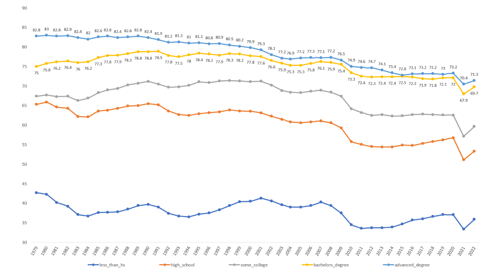

# Data Visualization and Storytelling

**English** | [简体中文](README.zh-CN.md)

Spreadsheet analysis and presentation work from **Inventor’s Lab: Data Visualization**, part of Cooper Union’s **STEM Saturdays** program in 2024. This collection includes a final project on U.S. employment patterns and four classroom exercises.

## Final project: U.S. employment patterns

How do employment patterns differ across age groups, education levels, and gender? The final project organizes a dataset labelled **1979–2022** into comparison tables, line charts, and gap calculations. A **22-slide presentation** and **bilingual speaking notes** turn those comparisons into an explanation for an audience.

The original presentation credits **Shaoxuan Xiong as producer** and **Richard Feng as editor**. The speaking notes retain the speakers’ section labels and rehearsal annotations.

[Explore the final project](final-project/employment-analysis) · [Download the presentation](final-project/employment-analysis/final-presentation.pptx) · [Open the workbook](final-project/employment-analysis/employment-analysis.xlsx) · [Read the speaking notes](final-project/employment-analysis/speaker-notes.md)

*An education-group comparison from the original presentation. Each line represents an education category; the saved chart’s year labels and values are retained.*

The project demonstrates organizing subgroup data, calculating differences, choosing charts, and explaining a visual comparison in an oral presentation. Its historical explanations are classroom interpretations. [Data notes](docs/DATA_NOTES.md) identify points to check before reusing the results, including year alignment and sums of annual percentages.

## Classroom exercises

| Exercise | What it contains | Open |
|---|---|---|
| Titanic | Passenger summaries, age and fare distributions, gender counts, and the class composition of survivors. | [Workbook and data](exercises/titanic) |
| Penny mass | Coin measurements, summary statistics, frequency counts, and normal-density calculations. | [Workbook and data](exercises/penny-mass) |
| Chart comparison | Two chart views of settlement time and its component stages, including a supplied forecast row. | [Workbook and data](exercises/chart-comparison) |
| Program selection | A five-slide recommendation comparing program popularity, audience groups, and production costs. | [Presentation](exercises/program-selection) |

## Using this repository

The seven original coursework files are preserved unchanged under descriptive filenames. CSV copies make the numerical tables readable on GitHub, and a Markdown copy makes the speaking notes accessible without Word. The original Excel files retain their formulas, charts, and layout.

- [File index and original filenames](docs/FILE_INDEX.md)
- [Dataset sources and credits](docs/SOURCES.md)
- [Data definitions and interpretation notes](docs/DATA_NOTES.md)

