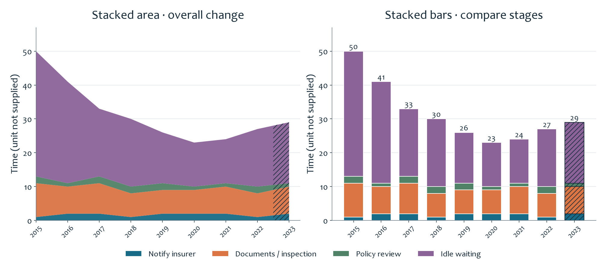

# One Dataset, Two Chart Views

**English** | [简体中文](README.zh-CN.md) · [All projects](../../README.md)

This exercise displays the **same insurance-settlement data** as a stacked area chart and a stacked bar chart, so viewers can compare what each format makes easier to see.

## What the charts show

Both charts split total settlement time into notifying the insurer, submitting documents or completing inspection, policy review, and idle waiting. The area chart emphasizes the overall change across years. The bars make it easier to compare the size of each stage within a particular year.

The recorded total falls from **50 in 2015 to 23 in 2020**, then rises to **27 in 2022**. Waiting is the largest component in every row. The **hatched 2023 section is a supplied forecast**, not an observed result. The worksheet does not state a time unit, so none has been assumed here.

## Technical work and learning

The workbook practices stacked area and stacked bar charts with a shared set of component series. Each total reconciles to the sum of its four stages. Comparing the two displays develops chart selection and part-to-whole interpretation, while separating actual values from forecasts. The page redraws the nine saved rows; the source workbook does not contain a forecasting formula.

[Original Excel workbook](settlement-time.xlsx) · [Nine data rows (CSV)](data/settlement-times.csv) · [Data notes](../../docs/DATA_NOTES.md)
