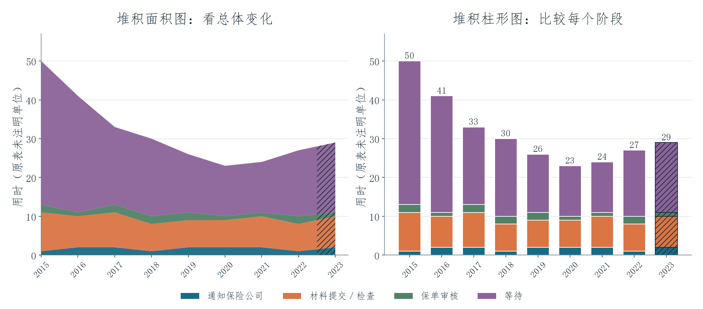

# 同一份数据，两种图表

[English](README.md) | **简体中文** · [全部项目](../../README.zh-CN.md)

这个练习把**同一份保险理赔用时数据**分别画成堆积面积图和堆积柱形图，比较不同图表让读者更容易看清哪些信息。

## 项目呈现效果

两张图都把总用时拆成通知保险公司、材料提交或检查、保单审核、等待四个阶段。左边的面积图更容易看出总用时随年份的整体变化；右边的柱形图则方便逐年比较，每个阶段分别占了多少。

原表总用时从 **2015 年的 50 降到 2020 年的 23**，随后升到 **2022 年的 27**。每一行中，等待都是用时最多的部分。**带斜线的 2023 年是练习提供的预测值**，需要与实际记录区分。原表没有注明时间单位，因此图中也没有自行写成“天”或“小时”。

## 技术实现与学习收获

工作簿使用相同的分阶段数据建立堆积面积图和堆积柱形图，各年的四项用时之和与总用时一致。这个练习让我练习根据阅读目的选择图表、解释整体与部分的关系，并区分实际值和预测值。页面预览依据原表 9 行数据重新绘制；原工作簿没有预测模型公式。

[原始 Excel 工作簿](settlement-time.xlsx) · [9 行数据 CSV](data/settlement-times.csv) · [数据说明](../../docs/DATA_NOTES.md)
