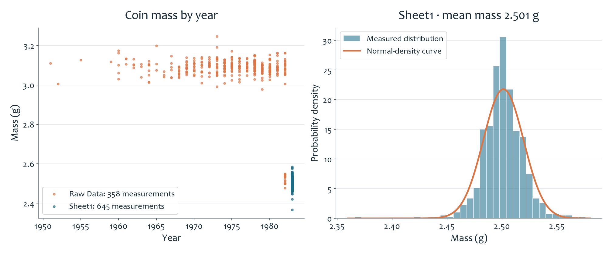

# Penny Mass Analysis

**English** | [简体中文](README.zh-CN.md) · [All projects](../../README.md)

This exercise compares **coin mass and mint year**, then looks more closely at how the measurements are distributed around their average.

## What the charts show

On the left, each dot represents a coin measurement. The **358 earlier-year measurements** cluster around 3.1 grams, while the **645 later-year measurements** cluster around 2.5 grams. Plotting year against mass makes the two groups visible at a glance.

On the right, the later-year measurements are grouped by mass. Their mean is **2.501 grams**, with a population standard deviation of about **0.018 grams**. The smooth normal-density curve gives a reference for comparing the observed concentration and tails; it does not establish that the measurements follow a normal distribution.

## Technical work and learning

The workbook combines `AVERAGE`, `STDEV.P`, frequency bins, and normal-density calculations. The exercise practices describing a distribution with both statistics and a chart, rather than relying on an average alone. These previews were redrawn from the saved measurements. Sheet2 contains an additional 528-row subset with an undocumented selection rule, so it is not added to the two groups as a separate sample.

[Original Excel workbook](analysis.xlsx) · [Earlier measurements](data/raw-data-sheet.csv) · [Later measurements](data/sheet1-measurements.csv) · [Additional subset](data/sheet2-subset.csv)

The classroom file is a worked copy of the Katz penny-mass activity; the source measurements are not presented as my own collection. [Sources and credits](../../docs/SOURCES.md) · [Data notes](../../docs/DATA_NOTES.md)
