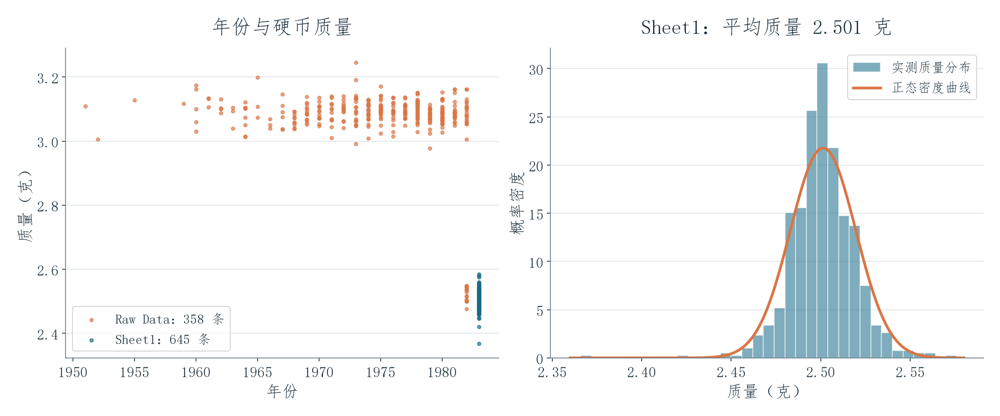

# 硬币质量分析

[English](README.md) | **简体中文** · [全部项目](../../README.zh-CN.md)

这个练习比较**不同年份硬币的质量**，再进一步观察硬币质量围绕平均值的分布情况。

## 项目呈现效果

左图中，每个点代表一次硬币测量。**358 条较早年份的测量值**大多集中在 3.1 克左右，**645 条较晚年份的测量值**大多集中在 2.5 克左右。把年份和质量放在同一张图上，就可以直接看出两组数据的差别。

右图把较晚年份的测量值按质量分组，显示大多数硬币集中在哪个范围。它们的平均质量为 **2.501 克**，总体标准差约为 **0.018 克**。平滑曲线提供一个正态分布的比较参照，帮助观察实测数据的集中程度和两端情况；画出这条曲线并不等于证明数据服从正态分布。

## 技术实现与学习收获

工作簿使用 `AVERAGE`、`STDEV.P`、频数分组和正态分布密度计算，把平均值、离散程度和分布图结合起来。这个练习让我练习用统计量和图形共同描述数据，避免只看平均数。页面预览依据原测量值重新绘制。Sheet2 另有 528 行子集，原文件未说明筛选规则，因此没有把它当成新的独立样本与前两组相加。

[原始 Excel 工作簿](analysis.xlsx) · [较早年份数据](data/raw-data-sheet.csv) · [较晚年份数据](data/sheet1-measurements.csv) · [额外子集](data/sheet2-subset.csv)

课堂文件是 Katz 硬币质量活动的练习版本，原始测量数据不作为我个人采集的成果。[来源与署名](../../docs/SOURCES.md) · [数据说明](../../docs/DATA_NOTES.md)
