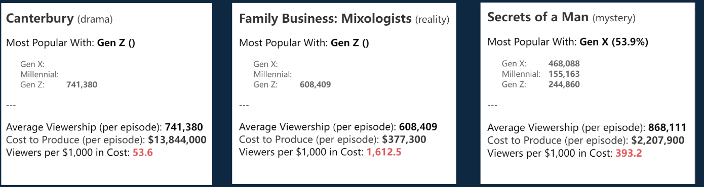

# Program Selection Recommendations

**English** | [简体中文](README.zh-CN.md) · [All projects](../../README.md)

This five-slide exercise uses **popularity, audience groups, and production costs** to recommend which programs to retain.

## What the presentation shows

The original presentation starts by comparing program types, recommending greater emphasis on comedy, science fiction, and reality shows. This turns a category-level visual comparison into a programming suggestion.

The candidate cards bring together audience information, average viewers, cost per episode, and viewers per $1,000 of production cost. The presentation recommends **Canterbury, Secrets of a Man, and two Family Business series**. The reasoning weighs both reach and production cost, rather than choosing only the most popular program.

## Technical work and learning

The exercise practices reading rankings and audience segments, comparing popularity against cost, and organizing a recommendation into slides. The images above are crops of the original slides, not newly calculated rankings. The underlying audience-and-cost workbook was not included in the saved materials, so the original numerical claims have not been independently reproduced.

[Original five-slide PowerPoint](presentation.pptx) · [Sources and credits](../../docs/SOURCES.md)
