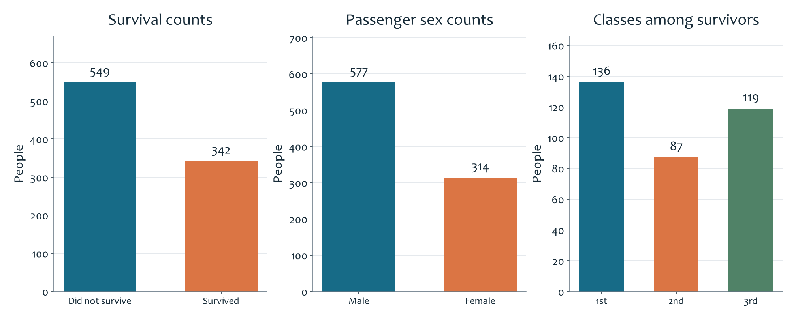
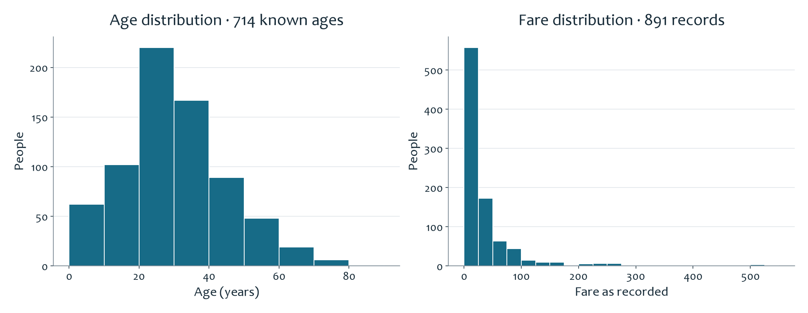

# Titanic Data Visualization

**English** | [简体中文](README.zh-CN.md) · [All projects](../../README.md)

This exercise turns **891 passenger records** into charts showing who was on board, how many survived, and how ages and fares were distributed.

## What the charts show

Of the 891 passengers, **342 survived and 549 did not**. The middle chart compares male and female passenger counts. The right chart breaks the 342 survivors into first, second, and third class: **136, 87, and 119 people**. This shows the composition of the survivor group; it does not show each class’s survival rate.

The age chart groups the **714 recorded ages** into intervals, making the concentration of younger adults easy to see. The fare chart shows many lower-priced fares and a small number of much higher values. Missing ages remain missing; they were not filled in to make this preview.

## Technical work and learning

The workbook uses `COUNTIF`, `SUM`, `AVERAGE`, population standard deviation, frequency calculations, and a PivotTable to summarize numeric and categorical fields. The exercise practices choosing between category counts and distribution charts, and checking the denominator when interpreting a percentage. The original workbook contains seven worksheets and five charts; these previews were redrawn from its saved data for browser viewing.

[Original Excel workbook](analysis.xlsx) · [Passenger data (CSV)](data/passengers.csv) · [Data notes](../../docs/DATA_NOTES.md)
