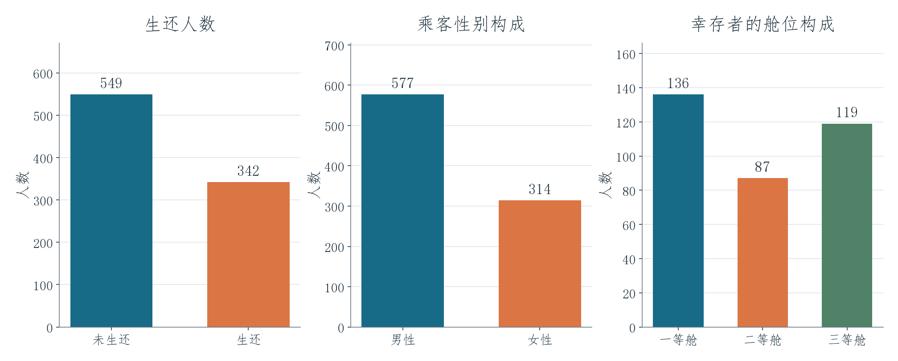
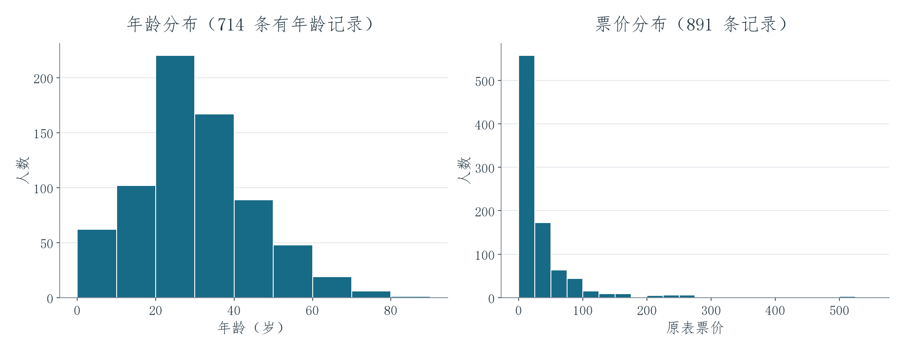

# Titanic 数据可视化

[English](README.md) | **简体中文** · [全部项目](../../README.zh-CN.md)

这个练习把 **891 条乘客记录**整理成图表，直接展示船上乘客的构成、生还人数，以及年龄和票价的分布。

## 项目呈现效果

891 名乘客中，**342 人生还，549 人未生还**。中间的图比较男性和女性乘客的人数；右边的图把 342 名幸存者按舱位分开，一等舱、二等舱和三等舱分别为 **136、87 和 119 人**。因此，读者能直接看清幸存者由哪些乘客组成。这里比较的是幸存者的舱位构成，不是各舱位的生还率。

年龄图把 **714 条有年龄的记录**分组，显示乘客年龄集中在哪些区间；票价图则显示，大部分票价较低，少数票价明显更高。相比逐行阅读乘客表，这两张图能更快展示数据的分布特点。原数据中缺失的年龄仍然保留为空，没有补造数值。

## 技术实现与学习收获

工作簿使用 `COUNTIF`、`SUM`、`AVERAGE`、总体标准差、频数计算和数据透视表，汇总数值字段与分类字段。这个练习让我练习区分分类计数与连续数据分布，并在解释百分比时明确分母。原工作簿有 7 个工作表和 5 张图表；页面中的预览依据原文件保存的数据重新绘制，方便直接浏览。

[原始 Excel 工作簿](analysis.xlsx) · [乘客数据 CSV](data/passengers.csv) · [数据说明](../../docs/DATA_NOTES.md)
