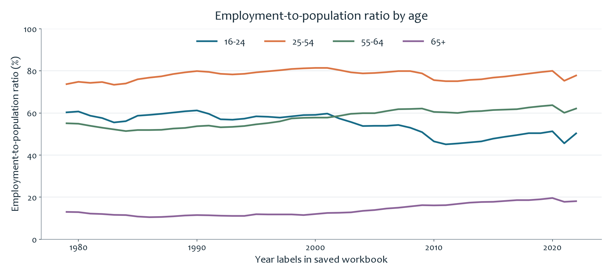
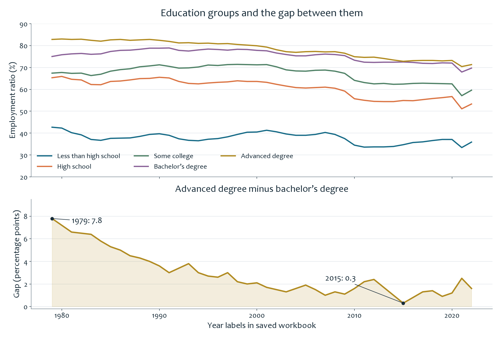
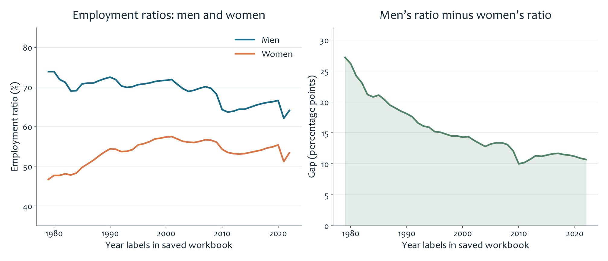

# U.S. Employment Patterns

**English** | [简体中文](README.zh-CN.md) · [All projects](../../README.md)

This final project turns **44 annual rows labelled 1979–2022** into visual comparisons of age, education, and gender. The measure is the **share of people in each group who are employed**. The completed work includes a seven-worksheet Excel analysis, a 22-slide presentation, and bilingual speaking notes.

## What the project shows

The four age-group lines make their different employment levels visible in one view. The 25–54 group lies above the other groups in the saved series, while the 65+ group is much lower. Following the lines also shows that groups change differently over time, rather than moving as a single national average.

The upper chart compares five education categories. The lower chart isolates the distance between the advanced-degree and bachelor’s-degree groups: **7.8 percentage points in 1979 and 0.3 points in 2015**. Showing the gap separately makes a small difference easier to see than comparing two nearby lines alone.

The left chart compares the men’s and women’s series; the right shows their difference for each saved year. This lets the audience see both employment levels and the changing distance between them. The workbook also includes gender comparisons within age, education, and race/ethnicity categories.

## Technical work and learning

The analysis organizes a 122-field source table into subgroup worksheets and uses line charts, bar charts, and subtraction formulas to compare ratios and percentage-point gaps. I practiced choosing a comparison, organizing the relevant series, and making a pattern visible without asking the audience to read the full table. The bilingual rehearsal notes connect those charts to spoken explanations, speaker transitions, and vocabulary practice.

The original presentation credits **Shaoxuan Xiong as producer** and **Richard Feng as editor**. The previews above were redrawn from saved workbook values. They preserve the saved year labels; year alignment and some original sums of annual percentages require review, as documented in the [data notes](../../docs/DATA_NOTES.md). These charts describe patterns and do not establish their causes.

## Original work

[Excel analysis](employment-analysis.xlsx) · [22-slide PowerPoint](final-presentation.pptx) · [Presentation PDF reading edition](final-presentation.pdf) · [Bilingual speaking notes](speaker-notes.md) · [Original Word notes](speaker-notes.docx)

[CSV data](data/) · [Detailed project explanation](PROJECT_EXPLAINED.md) · [Course learning reflection](../../docs/LEARNING.md)
