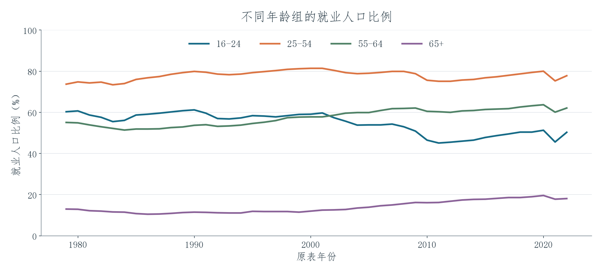
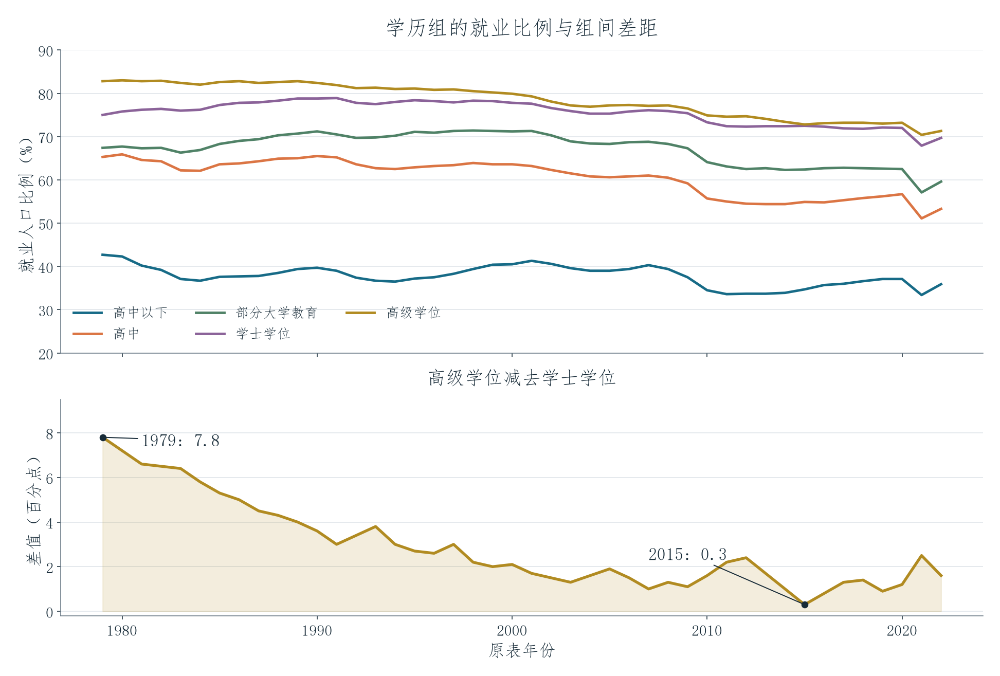
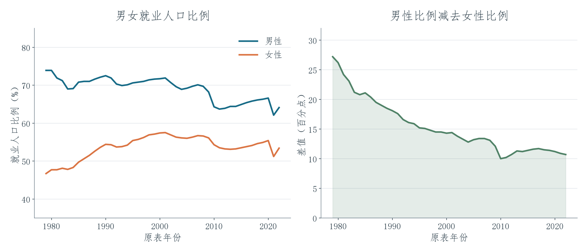

# 期末项目：美国就业数据中的群体差异

[English](README.md) | **简体中文** · [全部项目](../../README.zh-CN.md)

这个项目把标注为 **1979—2022 年的 44 行年度数据**整理成图表，从年龄、学历和性别三个角度比较就业情况。这里的就业人口比例，指的是**每个群体中有工作的人所占的比例**。最终成果包括 7 个工作表的 Excel 分析、22 页演示文稿，以及中英双语讲稿。

## 项目呈现效果

四条曲线把不同年龄组的就业水平放在同一张图里。原表中，25—54 岁组的比例高于其他组，65 岁以上组则明显较低。沿着曲线往后看，还能比较不同群体如何随时间变化，避免只用一个全国平均数概括所有人。

上图比较五类教育背景的就业比例，下图单独显示高级学位与学士学位两组之间的距离。原表中，两组在 **1979 年相差 7.8 个百分点，2015 年相差 0.3 个百分点**。把差值另外画出来，就不必仅靠两条很接近的曲线去判断差距有多大。

左图比较男性和女性的就业比例，右图显示原表中每一年的两组差值。这样，听众既能看到各组本身的就业水平，也能看清两组之间的距离如何变化。工作簿还进一步整理了不同年龄、学历和族裔类别中的男女比较。

## 技术实现与学习收获

分析从 122 个字段的原始表格中整理出不同群体的工作表，再通过折线图、柱形图和减法公式，比较比例与百分点差值。我练习了先确定比较问题，再整理相关数据序列，把变化转成听众能直接看到的图形。双语排练稿则把图表连接到口头讲解，让我练习用英语说明比较内容、衔接演讲部分，并准备相关词汇。

原演示文稿署名为 **Shaoxuan Xiong（制作）** 和 **Richard Feng（编辑）**。页面预览依据原工作簿保存的数值重新绘制，并沿用原表年份。年份对应关系和部分年度百分比求和仍需复核，具体列在[数据说明](../../docs/DATA_NOTES.md)中；图表呈现的是数据中的变化，不把可能的原因写成已被证明的结论。

## 原始成果

[Excel 分析](employment-analysis.xlsx) · [22 页 PowerPoint](final-presentation.pptx) · [演示文稿 PDF 阅读版](final-presentation.pdf) · [直接阅读双语讲稿](speaker-notes.md) · [原始 Word 讲稿](speaker-notes.docx)

[CSV 数据](data/) · [详细项目讲解](PROJECT_EXPLAINED.zh-CN.md) · [课程学习收获](../../docs/LEARNING.zh-CN.md)
